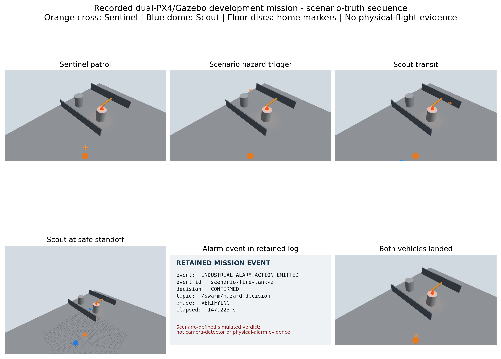

# Tiered Edge AI Architecture for Cooperative UAV-Based Industrial Fire Detection

Bachelor's thesis and research prototype by **Mohammadamin Jahanimajd**, University of Messina, Computer Science L-31, Data Analysis curriculum. Supervisor: **Prof. Giovanni Merlino**. Academic year: **2025/2026**. Defended in October 2026.

An onboard **Sentinel–Scout prototype** combines initial fire detection, temporal filtering, independent visual verification and correlated ROS 2 decisions across two heterogeneous UAV computers. The physical experiments were stationary with propellers removed. A separate ROS 2/PX4/Gazebo implementation exercised simulated aerial mission control.

**Research software, not an operational fire-alarm or flight-safety system.** Start with the [evidence boundaries](docs/EVIDENCE_STATUS.md) and [safety notes](docs/SAFETY.md).

## Thesis and defense

- [Final thesis PDF, 118 pages](publications/Jahanimajd_Thesis.pdf)
- [LaTeX source and build instructions](thesis/README.md)
- [Seven-minute defense PDF](publications/Jahanimajd_Defense.pdf)
- [Editable defense PowerPoint](publications/Jahanimajd_Defense.pptx), including notes and hidden examiner references
- [Continuous Gazebo mission recording](media/gazebo_full_mission.mp4)

The thesis PDF and defense files retain their final approved bytes. Personal graduation certificates, grades, identity records and submission receipts are deliberately not published.

## System

| Role | Physical platform | Onboard computation | Demonstrated function |
| --- | --- | --- | --- |
| Sentinel | Customized Holybro X500 V2, Pixhawk 6C, Intel RealSense D435i | Jetson Nano 4 GB, TensorRT FP16, containerized ROS 2 Foxy | Initial detection, three-frame trigger, event coordination and final decision |
| Scout | ModalAI PX4 Development Kit, onboard camera | VOXL 2 / QRB5165, TensorFlow Lite, native ROS 2 Foxy | Independent current-frame verification and a correlated verdict |

SwarmNet provides the onboard access-point network. The measured AI inference runs on the UAV computers, not on a ground station. Image-plane alert coordinates are **not geographic coordinates**. Scout verifies its own current camera view; it does not receive a transferred Sentinel image for inference.

The final measured hardware pair used a **640 × 640 Sentinel engine** and a **640 × 640 Scout model**. Earlier 416-pixel experiments and the later controlled six-model comparison are separate evidence. The hardware pair was implemented before that comparison and was not established as a universal model-selection winner.

## Selected measured results

| Experiment | Observation | Important boundary |
| --- | --- | --- |
| Sentinel decoder optimization | **72.1% lower mean pipeline time** | Separate before/after synthetic-input runs; not an accuracy or power saving |
| Exact deployed backend benchmark | Sentinel **58.151 ms**; Scout **999.431 ms** mean pipeline latency | Camera-free, 100 measured calls per device; different hardware/models/runtimes |
| Concurrent service run | **30,426** Sentinel frames; resource observation **1,939.7 s / 1,934.8 s** | No recorded crash/OOM/thermal shutdown in this stationary run |
| Resource constraints | Minimum available RAM **1,589.9 / 4,873.8 MiB**; peak thermal-zone readings **51.0 / 48.2 °C** | Sentinel / Scout, host-wide measurements; not electrical-power measurements |
| Loaded ROS 2/DDS exchange | **1,000 / 1,000** replies; **7.984 ms p95 RTT** | One stationary loaded-network run, not one-way latency or future delivery certainty |
| Physical workflow | **13/13** strong-flame requests confirmed; **0/6** direct unlit requests confirmed | Distinct bounded conditions; not population accuracy |
| Simulated mission | **4.5 m** commanded Scout standoff; both vehicles landed/disarmed by **214.253 s** | One accepted development run, scenario-supplied trigger/target/verdict |

Measured limits remain visible: small unstable flame **1/10** confirmations, Scout full-service p95 alert-to-verdict **2.618 s** against a **2 s** target, and Sentinel swap growth **0.922 MiB**. There was no integrated physical flight, industrial-site deployment, physical smoke evaluation, vision-derived geographic localization, completed 310-run simulation campaign or external predictive evaluation.



See the [results and evidence map](docs/EVIDENCE_STATUS.md) for exact records, units and distinctions between observations, interpretation and future work.

## Repository layout

```text
src/drone_enhanced_core/   Hardware-independent protocol, state machines and inference geometry
ros2_ws/src/              ROS 2 interfaces, Sentinel node and Scout node
simulation/               Distinct proxy assets, industrial world and runtime locks
config/                   Frozen experiment contracts and example device configuration
tools/                    Training/evaluation, deployment, capture and analysis utilities
tests/                    Portable tests and explicitly gated private-archive checks
docs/                     Reproduction guide, safety boundaries and dated experiment reports
artifacts/experiments/    Selected original quantitative records, not the complete private archive
evidence/                 Publication hashes and compact supporting records
thesis/                   Final LaTeX source, bibliography and required figures
publications/             One final thesis and one final defense version
media/                    Selected plots and accepted simulation recording
```

## Quick start: no hardware required

Use Python **3.12** for the host utilities and tests. The historical device runtimes are different and are documented separately.

```sh
python -m venv .venv
# Linux/macOS: source .venv/bin/activate
# Windows PowerShell: .venv\Scripts\Activate.ps1
python -m pip install -e .
python -m pip install -r requirements-dev.txt
python -m pytest tests -q
python tools/verify_publication.py
python tools/replay_coordination.py duplicate_confirmation
```

These commands test software and inspect bundled records. They do not connect to a drone, train models or rerun physical experiments. Five historical archive-dependent checks skip when their required private files are absent. A passing host suite is not hardware or flight validation.

Read [REPRODUCIBILITY.md](docs/REPRODUCIBILITY.md) before attempting device deployment, dataset reconstruction or PX4/Gazebo replay. This release does not bundle datasets, model weights/engines, third-party runtimes or the complete raw archive; full retraining is not possible from this checkout alone.

## Citation

Use [CITATION.cff](CITATION.cff) for repository metadata. To cite the dissertation:

```bibtex
@thesis{jahanimajd2026tiered,
  author = {Jahanimajd, Mohammadamin},
  title = {Tiered Edge AI Architecture for Cooperative UAV-Based Industrial Fire Detection},
  institution = {University of Messina},
  type = {Bachelor's thesis},
  year = {2026}
}
```

## License and material rights

Original software is released under **AGPL-3.0-only**; see [LICENSE](LICENSE). The thesis, slides, photographs, figures and experimental records are not granted a separate reuse license by this software license. Third-party material retains its own terms. See [RIGHTS_AND_DATA.md](RIGHTS_AND_DATA.md) and [THIRD_PARTY_NOTICES.md](THIRD_PARTY_NOTICES.md). No university or hardware-vendor endorsement is implied.

This is a curated first public release. Superseded drafts, recovery utilities, secrets, downloaded runtimes and private development history remain outside the public repository. Experimental failures and unmet criteria are retained in the scientific narrative and selected reports; they were not converted into successful results during cleanup.
